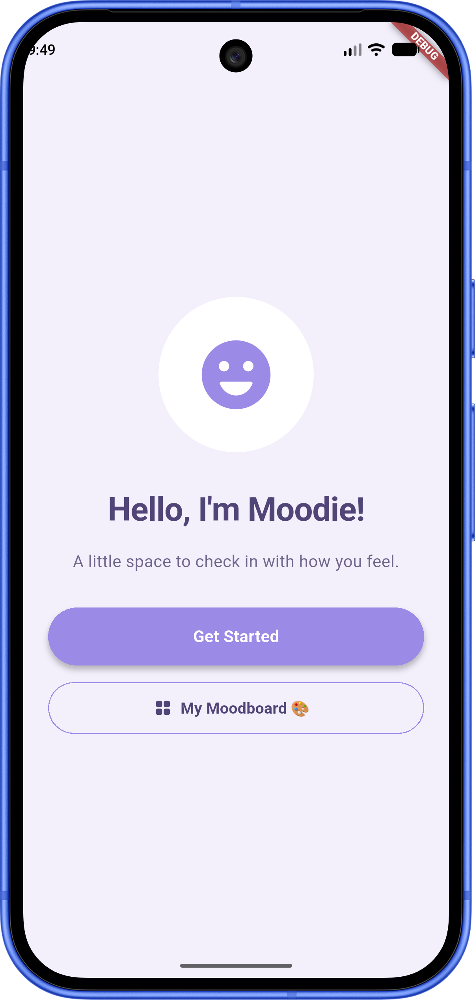
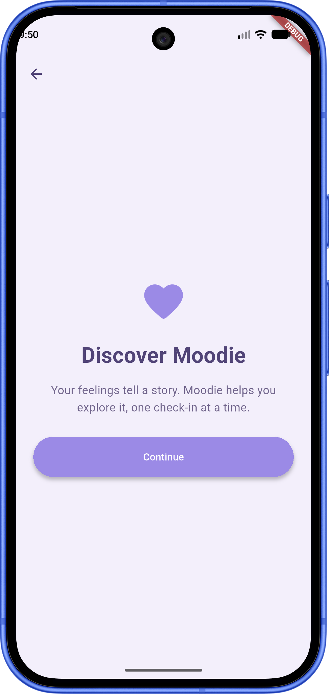
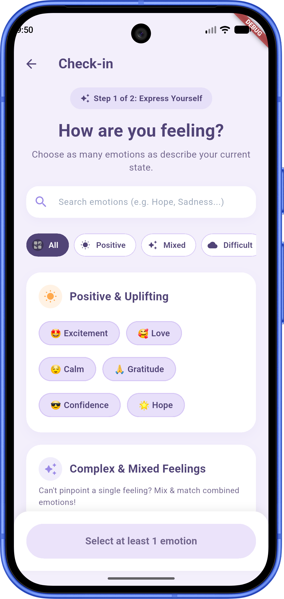
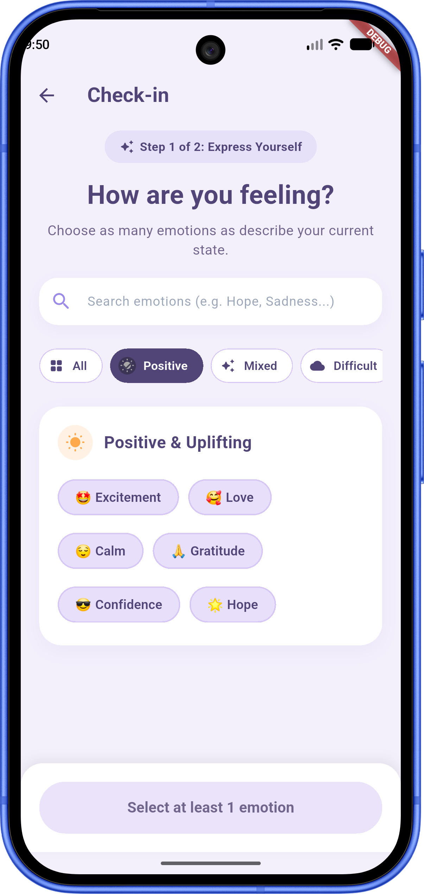
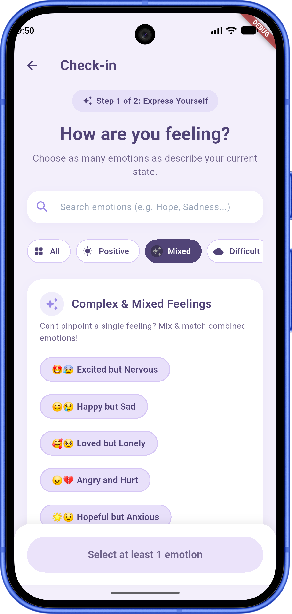
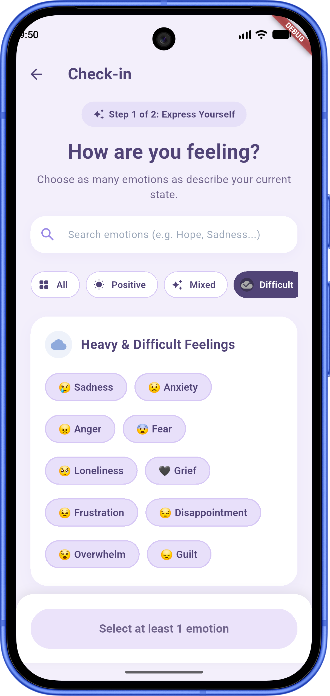
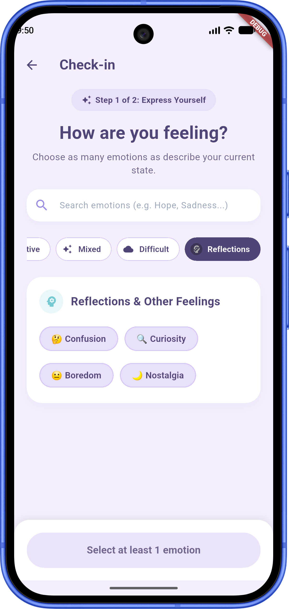
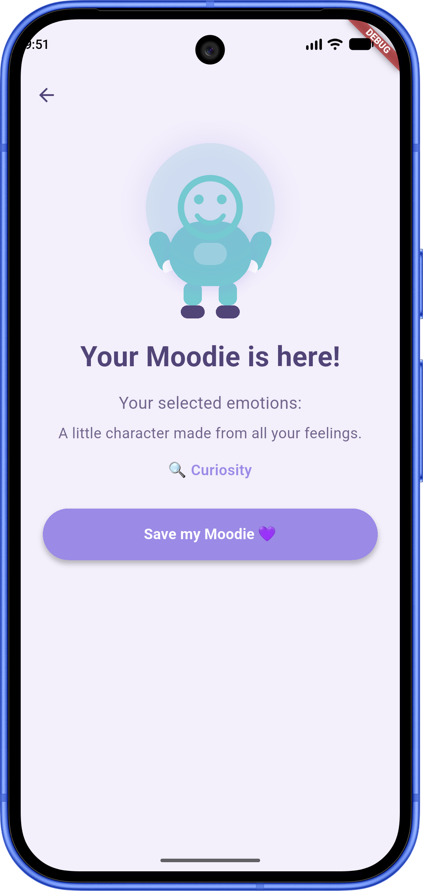
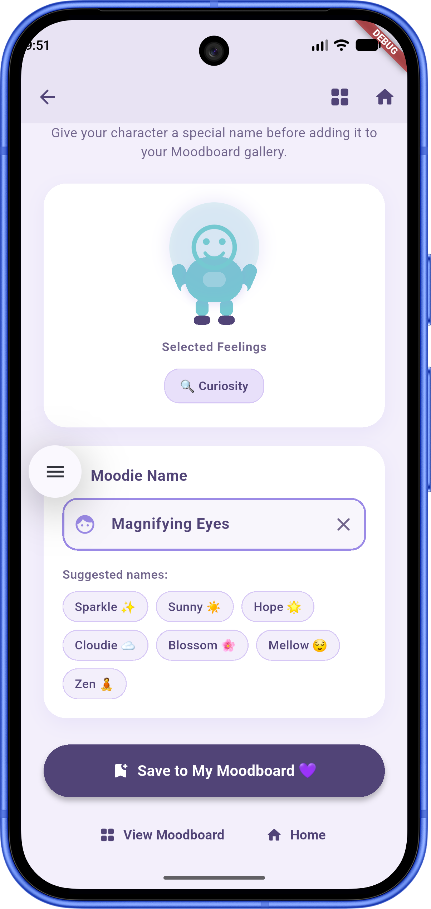
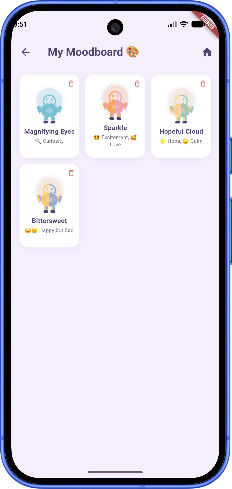

# Moodie 💜

**Check in. Feel it. Move forward.**

Moodie is a personalized mood-tracking Flutter application that transforms your emotions into unique, expressive cartoon characters. Select the feelings you are experiencing—or pick mixed emotion combinations—and watch Moodie render a custom cartoon character reflecting your exact emotional state.

---

## ✨ Key Features

- **Personalized Emotion Selection**: Choose from positive, difficult, mixed combination, and reflection emotion chips.
- **Category Filtering & Real-Time Search**: Filter emotions by category (*All*, *Positive*, *Mixed*, *Difficult*, *Reflections*) or search by keyword instantly.
- **Live Character Preview**: See your custom Moodie character update in real-time as you select and blend emotions.
- **Dynamic Multi-Column Color Shader**: Renders vertical multi-stripe gradients across the character corresponding to every selected emotion.
- **Full Moodie Body Visualizations**: Renders complete cartoon characters with head, facial expressions, torso, cute t-shirt overlay, arms, hands, legs, and shoes.
- **Save & Name Your Characters**: Give your personalized Moodie character a unique name with quick suggestion options.
- **Compact 3-Column Moodboard Grid**: Browse all your saved Moodie characters in a visual gallery grid.
- **Delete Saved Moods**: Easily delete saved Moodies with a single tap and confirmation dialog.
- **Dark Mode & Light Mode**: Adapts dynamically to system theme settings (`ThemeMode.system`).
- **Cross-Platform Support**: Mobile (Android/iOS), Web, and Desktop support with Material 3 styling.

---

## 🖼️ Application Screenshots & User Journey

### 1. Home / Welcome Screen

*The entry point welcoming users to check in with their feelings or view their Moodboard.*

---

### 2. Discover Moodie (Introduction)

*Introduces the Moodie philosophy and invites users to explore their feelings.*

---

### 3. Emotion Selection & Category Filters
*Choose from a rich library of emotions, search by keyword, or filter by emotional category.*

| All Emotions | Positive & Uplifting | Complex & Mixed |
| :---: | :---: | :---: |
|  |  |  |

| Heavy & Difficult | Reflections & Other |
| :---: | :---: |
|  |  |

---

### 4. Character Reveal Screen

*Visualizes your unique Moodie cartoon character with multi-column vertical emotion color stripes and full body details.*

---

### 5. Save Mood Screen

*Name your Moodie character with custom input or quick name suggestions before saving it.*

---

### 6. Moodboard Gallery Grid

*Browse, view, and manage all your saved Moodie characters in a 3-column gallery grid with deletion support.*

---

## 🌐 Web & Desktop Support

Moodie is fully compiled for Web and Desktop browsers (Google Chrome, Safari) with responsive layouts and full support for shaders, gradients, and Material 3 design.

#### Running on Web (Google Chrome):
```bash
flutter run -d chrome
```

#### Building Web Release:
```bash
flutter build web --release
```

---

## 📱 App Flow & Architecture

```
[ Welcome Screen ] ➔ [ Discover Moodie ] ➔ [ Emotion Selection ] ➔ [ Character Reveal ] ➔ [ Save Mood Screen ] ➔ [ Moodboard Grid ]
```

### File Structure (`lib/`)

- `main.dart`: App entry point, light/dark theme configurations, and Welcome home screen with Moodboard access.
- `introduction_screen.dart`: Introduces the user to the Moodie concept.
- `emotion_selection_screen.dart`: Interactive screen with emotion chips, category filter tabs, keyword search, live character preview, and bottom action bar.
- `character_reveal_screen.dart`: Displays the generated Moodie character with multi-stripe emotion gradients via `FullMoodieCharacter` widget.
- `save_mood_screen.dart`: Enables users to name and save custom Moodie characters, featuring suggested names and emotion chips preview.
- `moodboard_screen.dart`: Compact 3-column visual gallery displaying saved Moodie characters with deletion confirmation dialogs.

---

## 🛠️ Getting Started

### Prerequisites

- [Flutter SDK](https://flutter.dev) (^3.15.0)
- Android Studio / VS Code / Chrome Browser
- Android Emulator, iOS Simulator, or Web browser

### Installation

1. Clone the repository:
   ```bash
   git clone https://github.com/Starchild13/moodie.git
   cd moodie
   ```

2. Fetch Flutter dependencies:
   ```bash
   flutter pub get
   ```

3. Run the application:
   - **Mobile (Android Emulator)**:
     ```bash
     flutter run -d emulator-5554
     ```
   - **Web (Google Chrome)**:
     ```bash
     flutter run -d chrome
     ```

---

## 🧪 Testing & Code Quality

Run static analysis and formatting checks:

```bash
dart format lib/
flutter analyze
flutter test
```

---

## 👤 Author

Developed & maintained by **[Starchild13](https://github.com/Starchild13)**.

---

## 📄 License

This project is licensed under the MIT License - see the [LICENSE](LICENSE) file for details.

*Built with Flutter & Dart.*
